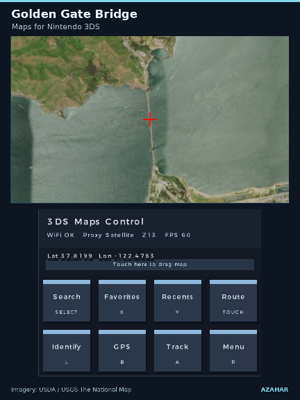
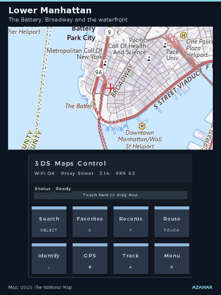
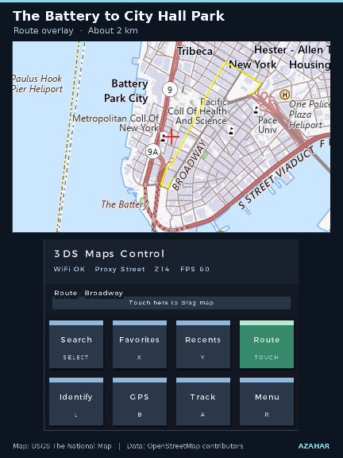
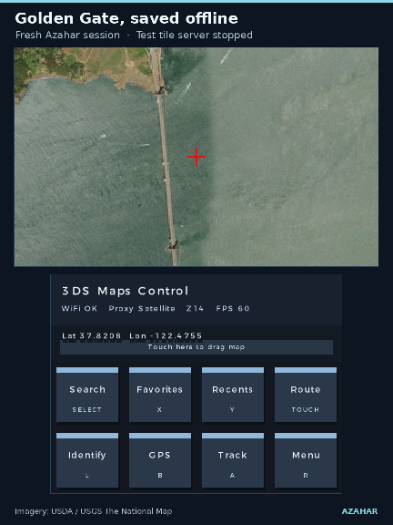

# Maps for Nintendo 3DS

Browse street maps and satellite imagery, search for places, and plan routes. Download map regions directly to your 3DS for offline use, or pair your phone to display your GPS position.

[Download .cia](#cia--home-menu) · [Download .3dsx][stable-3dsx] · [Installation guide](#install)

> **v2.1.0-preview.1** is prepared for publication. The offline regions workflow below was tested in Azahar. The current public download is [stable v2.0][stable-release].

  

*Golden Gate Bridge in Azahar. Imagery from USDA and USGS The National Map.*

[Offline map preview (GIF)](docs/media/maps-for-nintendo-3ds-preview.gif?raw=true) · [Full introduction video (MP4)](docs/media/maps-for-nintendo-3ds-intro.mp4?raw=true)

## Install

### .3dsx · Homebrew Launcher

1. Download [`3ds_google_maps.3dsx`][stable-3dsx].
2. Copy it to `sdmc:/3ds/3ds_google_maps/3ds_google_maps.3dsx`.
3. Open **Homebrew Launcher**, then select **3ds_google_maps**. The named offline pack workflow requires the [preview build](docs/usage.md#build-from-source).

### .cia · HOME Menu

The CIA is part of the prepared preview. On a 3DS with [custom firmware](https://3ds.hacks.guide/), copy the preview CIA to the SD card. In [FBI](https://github.com/Steveice10/FBI), open **SD**, select the file, and choose **Install CIA**. Return to the HOME Menu to launch **3DS Google Maps**.

[Preview release notes](docs/release/preview-notes.md)

## Try offline maps

1. Connect the 3DS to Wi-Fi. Tap **Search** or press **Select**, then look up a familiar place. Choose **A** to prefer results near the map center, or **X** to search everywhere when using the default search service.
2. Open **Menu → Data → Offline regions**. Press **L** for **Tile source** and enter a raster tile URL that permits offline downloads for the selected layer. The [tile source guide](docs/usage.md#tile-sources) includes a USGS imagery example for the contiguous United States.
3. Press **Y** for **New pack**. Start with a narrow zoom range and check the size estimate. Press **A** to name and download the pack, or **Select** for **Quick save**. **B** pauses a transfer. Select the paused pack and press **A** to resume.
4. Once the pack is ready, press **Start** to exit, switch off Wi-Fi, and reopen the app. In **Offline regions**, select the pack and press **A** to preview it. Browse the saved area at the zoom levels you downloaded.

Planning a new route requires a connection. With a route on screen, press **X** on the new pack screen to save a corridor of map tiles along it. This saves map coverage for the trip. Route calculation still uses the online routing service, and the route line itself does not persist with the pack.

## Use phone GPS

Connect the phone and 3DS to the same Wi-Fi network, or connect the 3DS to the phone’s hotspot if it permits local connections. On the 3DS, open **Menu → GPS** and tap **Server**. Scan the pairing QR on the top screen with the phone, open the local page, and allow location access. Keep the page open while using GPS. Press **A** on the map to toggle following your position.

The local GPS page uses a self-signed HTTPS certificate. Some browser setups will block the page or location access. See [GPS setup and troubleshooting](docs/usage.md#phone-gps) for what to check. The GPS QR pairs a phone to the running app.

## Explore

**Lower Manhattan** · Follow the waterfront and street grid.

**A route to City Hall Park** · The route overlay follows the streets from The Battery.

**A saved Golden Gate region** · The map reopens after the test tile server stops.

*All captures are from Azahar. The demo uses USGS topographic maps and USDA/USGS imagery through a test endpoint. Search and routing data © OpenStreetMap contributors. These captures do not establish physical console performance.*

| Control | Action |
| --- | --- |
| Circle Pad / D-Pad | Pan the map |
| **X** / **Y** | Zoom in / out |
| **Select** | Search |
| **L** | Identify the map center |
| **R** | Open settings |
| **B** / **A** on the map | Connect GPS / toggle GPS follow |
| **Start** | Exit and save the current view |

Use the touch panel for favorites, recents, and routing. Context-specific controls appear on the bottom screen. [Full controls and troubleshooting](docs/usage.md)

## Compatibility and issues

Both preview packages were built with devkitARM and launched in Azahar. Physical Old 3DS testing is pending, including live tile sources and HOME Menu banner playback. See the [verification record](docs/release/verification.md) for the exact coverage.

When [reporting an issue](https://github.com/Oldhimaster1/3ds-Google-Maps/issues/new/choose), include the console model or emulator version, app version or commit, and steps to reproduce it. For a tile problem, say which layer and provider you were using. Remove private locations, addresses, and pairing URLs before attaching logs or captures.

## Providers and development

The default street layer uses [OpenStreetMap](https://www.openstreetmap.org/copyright) and the default imagery layer uses [Esri World Imagery](https://www.arcgis.com/home/item.html?id=10df2279f9684e4a9f6a7f08febac2a9). Search uses [Nominatim](https://nominatim.org/) and route calculation uses [OSRM](https://project-osrm.org/). Offline packs use the tile source you configure. Provider terms apply separately from the app’s [MIT license](LICENSE).

[Build instructions, SD layout, and tilepack format](docs/usage.md#build-from-source) · [Contributing](CONTRIBUTING.md) · [Third-party licenses](THIRD_PARTY_LICENSES.md)

[stable-release]: https://github.com/Oldhimaster1/3ds-Google-Maps/releases/tag/v2.0
[stable-3dsx]: https://github.com/Oldhimaster1/3ds-Google-Maps/releases/download/v2.0/3ds_google_maps.3dsx
