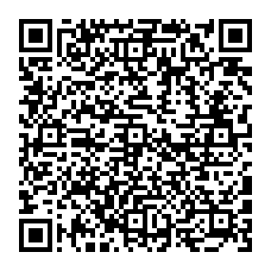
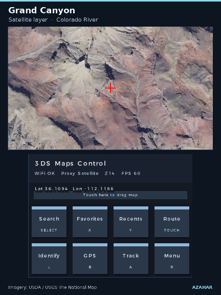

# Maps for Nintendo 3DS

Browse street maps and satellite imagery, search for places, and plan routes. Download map regions directly to your 3DS for offline use, or pair your phone to display your GPS position.

[Download v2.1 preview (.cia)][preview-cia] · [Download v2.1 preview (.3dsx)][preview-3dsx] · [Watch the v2.1 preview][preview-video] · [Installation guide](#install)

> The named offline regions shown here require **v2.1**. The links above serve the tested **v2.1.0-preview.1** packages. [Download stable v2.0 (.3dsx)][stable-3dsx] · [Preview SHA256SUMS][preview-sums]

  

*Golden Gate Bridge in Azahar. Imagery from USDA and USGS The National Map.*

[Offline map preview (GIF)](docs/media/maps-for-nintendo-3ds-preview.gif?raw=true) · [Full introduction video (MP4)](docs/media/maps-for-nintendo-3ds-intro.mp4?raw=true)

## Install

### .3dsx · Homebrew Launcher

1. Download the [v2.1 preview (.3dsx)][preview-3dsx].
2. Copy it to `sdmc:/3ds/3ds_google_maps/3ds_google_maps.3dsx`.
3. Open **Homebrew Launcher**, then select **3ds_google_maps**.

### .cia · HOME Menu

On a 3DS with [custom firmware](https://3ds.hacks.guide/), open [FBI](https://github.com/Steveice10/FBI) and choose **Remote Install → Scan QR Code**. Scan this code over Wi-Fi to download the v2.1 preview CIA.

You can also copy the [preview CIA][preview-cia] to the SD card. In FBI, open **SD**, select the file, and choose **Install CIA**. Return to the HOME Menu to launch **3DS Google Maps**.

[Preview release notes](docs/release/preview-notes.md)

## Try offline maps

Requires the v2.1 preview and a tile source that permits offline downloads. Configure the source for the layer you want to save.

The Azahar demo used a controlled tile endpoint. A separate direct USGS request hit a DNS error in Azahar. Check the [tile source guide](docs/usage.md#tile-sources) for compatible sources and setup.

1. Connect the 3DS to Wi-Fi. Tap **Search** or press **Select**, then look up a familiar place.
2. Open **Menu → Data → Offline regions**. Press **L** for **Tile source** and enter a raster tile URL that permits offline downloads for the selected layer. The [tile source guide](docs/usage.md#tile-sources) includes a USGS imagery example for the contiguous United States.
3. Press **Y** for **New pack**. Start with a narrow zoom range and check the size estimate. Press **A** to name and download the pack, or **Select** for **Quick save**. **B** pauses a transfer. Select the paused pack and press **A** to resume.
4. Once the pack is ready, press **Start** to exit, switch off Wi-Fi, and reopen the app. In **Offline regions**, select the pack and press **A** to preview it. Browse the saved area at the zoom levels you downloaded.

Planning a new route requires a connection. With a route on screen, press **X** on the new pack screen to save a corridor of map tiles along it. This saves map coverage for the trip. Route calculation still uses the online routing service, and the route line itself does not persist with the pack.

| Pack saved | Map reopened from the saved pack |
| --- | --- |
|  |  |
| Azahar checked all 16 tiles before exit. | After relaunch, the tile server was stopped and the browsing cache was empty. |

## Use phone GPS

Connect the phone and 3DS to the same Wi-Fi network, or connect the 3DS to the phone’s hotspot if it permits local connections. On the 3DS, open **Menu → GPS** and tap **Server**. Scan the pairing QR on the top screen with the phone, open the local page, and allow location access. Keep the page open while using GPS. Press **A** on the map to toggle following your position.

The local GPS page uses a self-signed HTTPS certificate. Some browser setups will block the page or location access. See [GPS setup and troubleshooting](docs/usage.md#phone-gps) for what to check. The GPS QR pairs a phone to the running app.

The preview accepted a simulated fix in Azahar. Physical phone pairing is pending.

## Explore

**Grand Canyon** · Follow the Colorado River through the canyon in imagery mode.

**A route to City Hall Park** · The route overlay follows the streets from The Battery.

*All captures are from Azahar. The demo uses USGS topographic maps and USDA/USGS imagery through a test endpoint. Search and routing data © OpenStreetMap contributors. These captures do not establish physical console performance.*

## Controls

| Control | Action |
| --- | --- |
| Circle Pad / D-Pad | Pan the map |
| **X** / **Y** | Zoom in / out |
| **Select** | Search |
| **L** | Identify the map center |
| **R** | Open settings |
| **B** / **A** on the map | Connect GPS / toggle GPS follow |
| **Start** | Exit and save the current view |

Use the touch panel for favorites, recents, and routing. Context-specific controls appear on the bottom screen. [Full controls and troubleshooting](docs/usage.md)

## Compatibility and issues

Both preview packages were built with devkitARM and launched in Azahar. Physical Old 3DS testing is pending, including live tile sources and HOME Menu banner playback. See the [verification record](docs/release/verification.md) for the exact coverage.

When [reporting an issue](https://github.com/Oldhimaster1/3ds-Google-Maps/issues/new/choose), include the console model or emulator version, app version or commit, and steps to reproduce it. For a tile problem, say which layer and provider you were using. Remove private locations, addresses, and pairing URLs before attaching logs or captures.

## Providers and development

The default street layer uses [OpenStreetMap](https://www.openstreetmap.org/copyright) and the default imagery layer uses [Esri World Imagery](https://www.arcgis.com/home/item.html?id=10df2279f9684e4a9f6a7f08febac2a9). Search uses [Nominatim](https://nominatim.org/) and route calculation uses [OSRM](https://project-osrm.org/). Offline packs use the tile source you configure. Provider terms apply separately from the app’s [MIT license](LICENSE).

[Build instructions, SD layout, and tilepack format](docs/usage.md#build-from-source) · [Contributing](CONTRIBUTING.md) · [Third-party licenses](THIRD_PARTY_LICENSES.md)

[stable-3dsx]: https://github.com/Oldhimaster1/3ds-Google-Maps/releases/download/v2.0/3ds_google_maps.3dsx
[preview-video]: docs/media/maps-for-nintendo-3ds-intro.mp4?raw=true
[preview-cia]: https://raw.githubusercontent.com/Oldhimaster1/3ds-Google-Maps/c5ce07ae55b5d201875f818bf74a88f6b30a9f5b/3ds_google_maps.cia
[preview-3dsx]: https://raw.githubusercontent.com/Oldhimaster1/3ds-Google-Maps/c5ce07ae55b5d201875f818bf74a88f6b30a9f5b/3ds_google_maps.3dsx
[preview-sums]: https://raw.githubusercontent.com/Oldhimaster1/3ds-Google-Maps/c5ce07ae55b5d201875f818bf74a88f6b30a9f5b/SHA256SUMS
