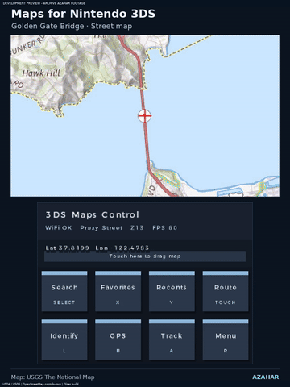
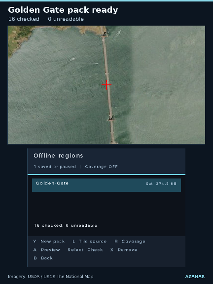

# Maps for Nintendo 3DS

**Explore the world. Find the place. Pass the console.**

**2.2.0 RC3 — ready to try, still awaiting testing on a real 3DS.**
The GIF above and the [25-second teaser](docs/media/rc1-archive-teaser.mp4?raw=true)
use **archived Azahar footage of the older map build**. They do not demonstrate
this candidate's new Street View, globe or game features. Fresh RC3 captures are being prepared.

[Download candidate CIA][rc-cia] · [Download candidate 3DSX][rc-3dsx] ·
[Checksums][rc-sums] · [20-requirement verification report](docs/release/rc1/acceptance.md) ·
[Stable v2.0 fallback][stable]

## What is in this candidate?

Browse maps, save places for offline use, connect your phone for GPS, or take a
detour into Street View and StreetGuess. RC3 brings **32 curated locations across
21 countries**, Mystery Expeditions, daily and friend challenges, pass and play,
and Country Streak records that stay saved when you restart.

This is a development preview for review. The automated checks and clean build
have passed; Wi-Fi, gyro feel and performance still need testing on real hardware.

| Experience | Included behavior | Important limit |
| --- | --- | --- |
| Maps and offline regions | Pan, search, favorites, named packs, pause/resume and integrity checks | Download only from sources permitting offline use. |
| Street View | Multi-provider explorer, gyro controls, navigation and fly-in | Physical gyro/navigation unverified; Google/Bing remain experimental. |
| Panorama detail | View-selected Google zoom 2–4 curved detail overlay | **One central tile**, with low-resolution fallback; provider authorization unresolved. |
| Globe | Rotatable Blue Marble globe with on-demand NASA GIBS detail and optional stereo | Historical composite, **not real-time satellite photography**; one detail patch. |
| Terrain and buildings | Selected-location Terrarium elevation; optional real OSM building footprints | Single terrain tile; simple buildings only; no fabricated fallback structures. |
| Classic StreetGuess | World / US / Europe; Moving / No Move / NMPZ; timers and records | Google-only random mode depends on experimental access and coverage. |
| Daily and friend challenges | Exact versioned locations, five rounds, three difficulties, UTC records/history | **32 locations in 21 countries**, still Europe-heavy. Correct console UTC clock required. |
| Pass and play | Two to four players, identical rounds, handoff screens and final scores | Local trust-based play; no accounts or online leaderboard. |
| Discovery modes | Surprise Me, five-stop Mystery Expeditions and Country Streak with saved personal bests | Curated locations, not an unlimited worldwide library. Streaks continue beyond five answers. |
| Custom controls | Four profiles, eleven digital buttons, conflict-free swaps and saved settings | START is fixed. StreetGuess captions follow your selected bindings; some older screens retain default captions. |
| Routing | Route overlay, remaining distance, estimated ETA and off-route reroute logic | No verified full turn-by-turn guidance. |

[RC3 changes and test results](docs/release/rc3/verification.md)

## Install the candidate

Back up your SD saves and retain the stable download before upgrading. The CIA
keeps title ID **000400000FD34B00** and will replace the installed app with that ID.
The previous public releases and existing preview files have not been replaced.

**HOME Menu:** on an appropriately configured homebrew console, use FBI → Remote
Install → Scan QR Code, or copy the [candidate CIA][rc-cia] to the SD card and
install it with FBI. The QR below targets the exact commit-pinned candidate file.

**Homebrew Launcher:** copy the [candidate 3DSX][rc-3dsx] to
`sdmc:/3ds/3ds_google_maps/3ds_google_maps.3dsx` and launch it from Homebrew Launcher.
The QR has been decoded and the download checked. Scanning and installing with FBI on a real console still need testing.

## Play together

Open Settings → the Explore page → **Play StreetGuess**. On its game menu,
press **Select** to open the challenge menu. **X** changes mode, **Y** changes
difficulty, and **A** starts. Touch cards choose two to four players, enter a
friend code or show UTC daily history.

Explorer difficulty provides hints without a timer. Standard uses No Move with
120 seconds. Expert uses NMPZ with 60 seconds. The code includes the exact dataset,
seed and difficulty. Send or photograph the score screen and `SG1` code; a friend
enters it on the challenge menu. Pass and play reuses the same five locations for
each player. Other players should look away while a turn is in progress.

A missing challenge image stops with a retry screen and does not consume a round.
There is no substitute location that could make scores incomparable. Daily play
uses the console clock interpreted as UTC; there is no trusted time server,
account, forced check-in or reward loss for taking a break. Records are local and
are not cheat-proof.

## Controls and accessibility

| Default button | Map action |
| --- | --- |
| Circle Pad / D-pad | Pan |
| X / Y | Zoom in / out |
| Select | Search |
| L | Identify center |
| R | Settings |
| B / A | GPS connection / follow |
| START | Exit / fixed escape; in StreetGuess, pause |

Settings → More → page 3 contains four remap profiles, action selection, physical
binding and restore-defaults. Assigning an occupied button swaps its old action.
Touchscreen and Circle Pad access remain available. Text size, weight, contrast,
stick sensitivity and gyro options are retained. Some old captions still show
logical/default buttons; see the verification report before relying on remapping.

## Phone GPS

Use the same trusted local Wi-Fi network. Start the GPS server and scan its
**private session QR** with the phone. The browser must accept the local
self-signed certificate and allow location access; some phones may block this
flow. This candidate generates a fresh certificate and secret each session,
requires authenticated submissions, and removes exact positions from phone status
text and request URLs from network logs. Physical pairing remains unverified.

Keep the browser in the foreground. A locked screen may pause updates. Rescan after
restarting the server or reloading a tab that has lost its pairing token. Do not
include the pairing QR, private coordinates or addresses in shared screenshots.
[Security and provider review](docs/release/rc1/provider-review.md)

## Screenshot gallery and video

These are **archived Azahar captures of the older map preview**, using USGS maps
and USDA/USGS imagery through a controlled endpoint. They are not RC1 acceptance
screenshots and do not establish original-3DS performance.

| Maps | Routing | Offline regions |
| --- | --- | --- |
|  |  |  |

[Archived 45-second introduction](docs/media/maps-for-nintendo-3ds-intro.mp4?raw=true) ·
[New 25-second archive teaser](docs/media/rc1-archive-teaser.mp4?raw=true) ·
[Offline GIF](docs/media/rc1-offline-archive.gif) · [Route GIF](docs/media/rc1-route-archive.gif)

A complete 2–4-minute RC3 demonstration, physical-console shots and screenshots of
Street View/detail, globe, terrain/buildings, daily games and custom settings are
**not available yet**. The [media evidence and shot list](docs/release/rc1/media.md)
lists the remaining shots. See the [RC3 recording notes](docs/release/rc3/media.md) for current captures.

## Compatibility and troubleshooting

Original 3DS is the intended baseline; New 3DS/XL is also targeted. Both use the
same candidate source. Testing on both physical console models is still pending. RC3 launches in
Azahar and renders cached map imagery and the globe. Direct hostname lookup
fails in this recording environment, so online imagery and gameplay are not yet
fully verified there. Archived clips above belong to the older preview.

- **No online imagery:** check Wi-Fi and console date, try another permitted provider, and read its status. HTTPS now fails on invalid certificates instead of bypassing verification.
- **Challenge unavailable:** retry later. Keep the same dataset and code; do not replace a missing round manually.
- **No buildings:** enable buildings and wait for Overpass; missing OSM coverage or capacity is reported honestly.
- **No terrain:** elevation requires Wi-Fi; one coarser parent tile may be attempted.
- **Damaged settings:** invalid mappings fall back to defaults on startup. Retain backups of records and SD data.
- **An issue persists:** report console model, exact source commit, provider, reproduction steps and sanitized logs. Never attach a live GPS pairing QR.

## Build, credits and release gates

Start with `sh tests/run-feature-integration-host.sh`; run the full checkout gate
with `sh tests/run-all-host.sh`. See [build instructions](docs/usage.md#build-from-source)
and [candidate validation](docs/release/rc1/acceptance.md). The local devkitARM build produced matching CIA and 3DSX packages. GitHub Actions
has not been used as evidence for this candidate.

Map data © [OpenStreetMap contributors](https://www.openstreetmap.org/copyright).
NASA GIBS / Blue Marble; Mapzen elevation and source datasets; Panoramax image
creators and license links are listed in the immutable
[challenge manifest](docs/datasets/streetguess-v1.json). Optional providers retain
their own access terms. Google and Microsoft integrations have unresolved
production-permission gates. This project is not affiliated with Nintendo,
Google, NASA or the imagery providers.

[Third-party licenses](THIRD_PARTY_LICENSES.md) · [MIT source license](LICENSE) ·
[Provider review](docs/release/rc1/provider-review.md) · [RC3 verification](docs/release/rc3/verification.md)

[stable]: https://github.com/Oldhimaster1/3ds-Google-Maps/releases/download/v2.0/3ds_google_maps.3dsx
[rc-cia]: https://raw.githubusercontent.com/Oldhimaster1/3ds-Google-Maps/9cc4858b5fca0cb8d3806ead7ed0b960c7f144fb/preview-builds/rc3/3ds_google_maps.cia
[rc-3dsx]: https://raw.githubusercontent.com/Oldhimaster1/3ds-Google-Maps/9cc4858b5fca0cb8d3806ead7ed0b960c7f144fb/preview-builds/rc3/3ds_google_maps.3dsx
[rc-sums]: https://raw.githubusercontent.com/Oldhimaster1/3ds-Google-Maps/9cc4858b5fca0cb8d3806ead7ed0b960c7f144fb/preview-builds/rc3/SHA256SUMS
