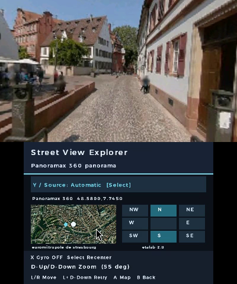
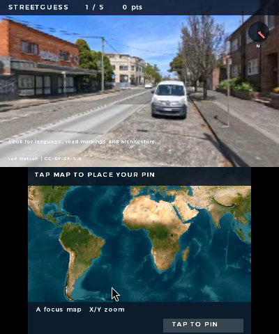
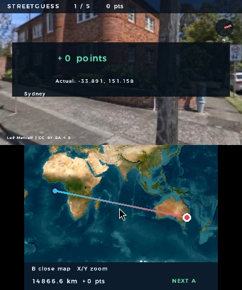
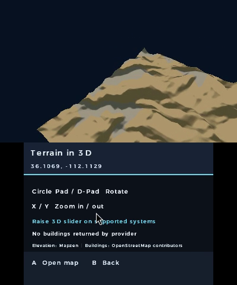
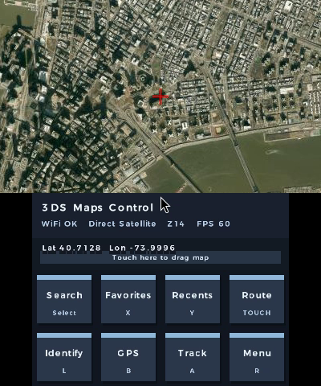

<div align="center">

# Maps for Nintendo 3DS

**Explore the world. Find the place. Pass the console.**

Maps, real street panoramas, a globe you can spin, and geography challenges to play with friends — all on your Nintendo 3DS.

Pick somewhere you've never been. Wander down a street, take a closer look at the landscape, or find out how well you really know the world.


**[Download the latest release](#download)** · **[Watch the teaser](docs/media/rc3/teaser.mp4?raw=true)** · [What's new since v2.0](#whats-new-since-v20) · [How to install](#download)

</div>

## What's new since v2.0?

The original release was mainly about browsing maps, searching for places, planning routes and taking maps offline. This version takes things a lot further.

- **Street View Explorer:** Find real panoramic imagery, look around, follow connected viewpoints and try motion controls on a New 3DS. Panoramax, KartaView and optional Mapillary are supported; Google and Bing integrations are experimental.
- **A globe in your pocket:** Spin the Earth, zoom back into maps and explore NASA Blue Marble imagery, with extra historical GIBS detail where available.
- **3D places:** Explore elevation near your chosen location and simple OpenStreetMap buildings, including stereoscopic views on supported 3DS models.
- **StreetGuess:** Guess where you are from street imagery, play daily challenges, share a friend code, or pass the console around.
- **Better everyday maps:** More flexible search, offline regions, favorites, route progress and estimated arrival times, plus phone-based GPS following.
- **Your controls, your way:** Four remapping profiles, text-size options, contrast settings and adjustable gyro behavior.

Some of these features require Wi-Fi and nearby imagery. [Full version changes and known limits](docs/releases/v2.2.0.md).

## Explore somewhere new

**Browse the world.** Pan and zoom around street maps and satellite imagery, search for a place, save a favorite or prepare supported map regions for offline use.

**Step into the street.** Enter Street View Explorer to look around a real panorama. Follow an available connection to another viewpoint or use the minimap to see where you are. On a New 3DS, you can try the gyro for looking around. Imagery coverage varies by location and provider.

**Spin the globe.** Zoom all the way out to leave the flat map behind. The globe works with bundled Blue Marble imagery and can request more detailed NASA imagery when online. It's a beautiful Earth viewer, not a real-time satellite feed.

**See some depth.** Switch to terrain or nearby buildings in Explore. Elevation is loaded for the selected area, and building shapes come from available OpenStreetMap data. Raise the 3D slider on a compatible 3DS to try stereoscopic views.

**Bring your phone for GPS.** Pair a phone on the same trusted Wi-Fi network and let the map follow your position. You can also search for places, plot a route and follow its progress.

## StreetGuess — where in the world are you?

Look for clues in the panorama, place a pin on the map, and see how close your guess was. Play alone or turn it into a competition.

- **Classic:** Five-round games with World, US and Europe options, movement rules and timers.
- **Daily Challenge:** The same five curated places for players on the same UTC day and dataset version.
- **Friend Challenges:** Share a code so someone else can play the same locations and rules.
- **Pass and Play:** Two to four people share a console and take turns.
- **Country Streak:** Name the country and see how long you can keep your streak alive.
- **Mystery Expeditions and Surprise Me:** Let the game pick somewhere unexpected.

There are currently **32 curated panorama locations across 21 countries**, plus classic random-location play. Explorer difficulty offers hints without a timer; Standard and Expert provide a bigger challenge. Your records stay on the SD card, and no online account is required.

The curated challenges use Panoramax imagery. Classic random play uses experimental Google imagery and may not work in every area. Missing challenge images can be retried without losing the round.

[How StreetGuess works](docs/streetguess.md)

## See it in action

| Explore a real panorama | Spin the Earth |
| :---: | :---: |
|  |  |
| **Make a StreetGuess guess** | **See the actual result** |
|  |  |
| **Explore live elevation** | **Explore Manhattan** |
|  |  |

**[Watch the 20-second teaser](docs/media/rc3/teaser.mp4?raw=true)** · [Watch the 32-second showcase](docs/media/rc3/review-walkthrough.mp4?raw=true)

### Real gameplay clips

These are short, genuine recordings of the newer features. They haven't yet been edited into the teaser or showcase:

**[Look around a 360° panorama](docs/media/rc3/capture-sources/panorama-look.mp4?raw=true)** · [Move to another viewpoint](docs/media/rc3/capture-sources/panorama-move.mp4?raw=true) · [Make a guess and reveal the score](docs/media/rc3/capture-sources/daily-guess.mp4?raw=true) · [Explore live 3D terrain](docs/media/rc3/capture-sources/terrain.mp4?raw=true)

*These clips were captured in Azahar from RC3 application code, with recording-only network and clock adjustments. They aren't physical-console performance footage. The published CIA and 3DSX do not include those recording adjustments. [Capture details](docs/media/rc3/capture-sources/README.md).*

## Download

**Latest production release:** The links below follow GitHub's latest published stable release. You need a homebrew-enabled Nintendo 3DS-family system. This is a major feature upgrade over the [original v2.0 release][stable]; some advanced features still need wider real-hardware testing.

**[Download CIA][cia]** · **[Download 3DSX][three]** · [GPS maintenance build SHA-256 checksums][sums] · [All releases](https://github.com/Oldhimaster1/3ds-Google-Maps/releases)

### Install with FBI

On your 3DS, open **FBI → Remote Install → Scan QR Code** and scan this **permanent production QR**. It always points to the CIA attached to GitHub's latest stable release, including future release updates. This is separate from the *private GPS pairing QR* generated on your 3DS.

<div align="center">


</div>

You can also copy the CIA to your SD card and install it in FBI. The CIA uses the same title ID as earlier versions, so **back up your saves and app data before upgrading**.

### Install with Homebrew Launcher

Download the 3DSX and copy it to:

```text
sdmc:/3ds/3ds_google_maps/3ds_google_maps.3dsx
```

Then launch it from the Homebrew Launcher.

## Getting started

1. **Explore the map:** Use the Circle Pad or D-pad to move, **X/Y** to zoom, **Select** to search, and **R** for settings.
2. **Try a globe or panorama:** Open **Settings → Explore**, or zoom out past the smallest map zoom to enter the globe. Street View needs an internet connection and available imagery.
3. **Play StreetGuess:** Choose **Settings → Explore → Play StreetGuess**. Press **Select** to open the challenge menu, then choose a mode or a friend code.
4. **Connect your phone for GPS:** Use the GPS server option while both devices are on the same trusted Wi-Fi. Scan the private pairing QR, allow location access and keep that QR private.

[Full map controls](docs/usage.md) · [Explore and gyro guide](docs/explore.md) · [StreetGuess guide](docs/streetguess.md)

## A few useful tips

- Download a small offline region before heading somewhere without Wi-Fi. Only use tile sources that permit offline downloads.
- Zoom into a panorama to try higher-resolution detail on supported imagery. It improves a central section rather than sharpening the entire panorama at once.
- Daily challenges follow **UTC**, so check that your console clock is accurate.
- If street imagery isn't available nearby, try a different provider or location.
- Adjust text size, contrast or button mappings in Settings if the default layout isn't comfortable.

## FAQ

**Does it run on the original 3DS?**  
The original 3DS is the performance target, with New 3DS models supported by the same source. Several features have run in Azahar, and the GPS reliability update was reported working with a physical 3DS and iPhone. Complete original/New 3DS testing, including gyro and stereo behavior, remains in progress.

**Does StreetGuess need an account?**  
No. Daily challenges, friend codes and local records work without accounts or an online leaderboard. Street imagery still needs a working network connection.

**Why isn't Street View available everywhere?**  
Coverage depends on the imagery provider. Panoramax, Mapillary and KartaView have different coverage; Google and Bing remain experimental and have unresolved access permissions. [Provider details](docs/release/rc1/provider-review.md).

**Can I use everything without Wi-Fi?**  
Previously cached maps and supported offline regions can work offline, and the basic globe uses bundled imagery. Fresh street panoramas, live elevation/building data and most online services need Wi-Fi.

**Is the globe showing the Earth right now?**  
No. It uses NASA's Blue Marble composite imagery and additional GIBS detail when available.

**What if something doesn't work?**  
Check the [troubleshooting guide](docs/usage.md#troubleshoot) and [known limitations](docs/release/rc3/verification.md#feature-scope-and-known-limits), or [open an issue][issues]. Do not include a private GPS pairing QR or your exact location in public screenshots.

## Build, credits and license

The project is open source. [Build it with devkitPro](docs/usage.md#build-from-source) or browse the [release changes](docs/releases/v2.2.0.md).

Maps © [OpenStreetMap contributors](https://www.openstreetmap.org/copyright). Satellite imagery shown in the current gallery is credited to Esri and contributors; the globe uses NASA Blue Marble/GIBS. Elevation uses Terrarium data, and street imagery belongs to its credited creators. [StreetGuess image credits and licenses](docs/datasets/streetguess-v2.json) · [Third-party licenses](THIRD_PARTY_LICENSES.md).

This is an independent homebrew project, not affiliated with Nintendo, Google, NASA or the imagery providers.

[MIT License](LICENSE) · [Report a problem][issues] · [Original v2.0][stable]

[stable]: https://github.com/Oldhimaster1/3ds-Google-Maps/releases/tag/v2.0
[issues]: https://github.com/Oldhimaster1/3ds-Google-Maps/issues
[cia]: https://github.com/Oldhimaster1/3ds-Google-Maps/releases/latest/download/3ds_google_maps.cia
[three]: https://github.com/Oldhimaster1/3ds-Google-Maps/releases/latest/download/3ds_google_maps.3dsx
[sums]: docs/releases/gps-maintenance-SHA256SUMS
