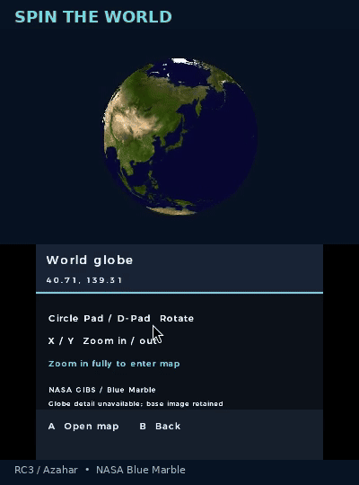
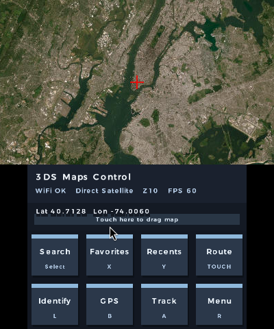
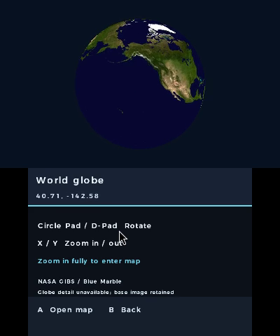
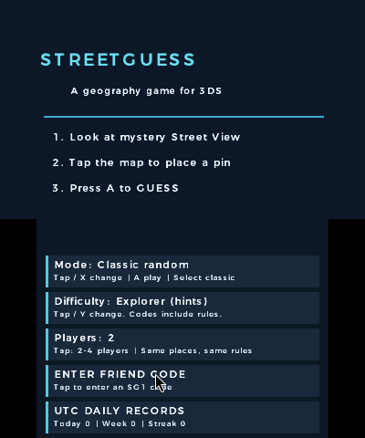
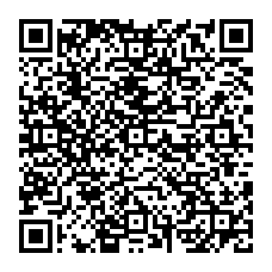

<div align="center">

# Maps for Nintendo 3DS

**Explore the world. Find the place. Pass the console.**

Maps, real street panoramas, a globe you can spin, and a geography game to play
with friends — all on your Nintendo 3DS. Pick somewhere you’ve never been, take
a look around, or see how well you really know the world.

[**Get the RC3 preview**](#download) · [See it in action](#see-it-in-action) ·
[What’s inside](#what-can-you-do) · [Getting started](#getting-started) · [FAQ](#faq)



*Eight seconds around the world. Captured from RC3 running in Azahar.*

</div>

## What can you do?

**Go exploring.** Pan around the map, look up places, save your favourites and
download supported map regions for later. It’s a surprisingly fun way to get
lost without going anywhere.

**Take a walk down another street.** Open panoramic street imagery, look around
and move between available viewpoints. On a New 3DS, you can also try looking
around with the gyro. Several imagery sources are available; coverage varies,
and Google and Bing support is experimental.

**See the planet from above.** Spin the 3D globe and zoom back into the map.
It uses Blue Marble Earth imagery, with extra NASA image detail fetched when
available. Think of it as a globe to explore, not a live satellite feed.

**Give the landscape some depth.** Explore elevation and simple 3D buildings
where the services have data, and try the stereoscopic 3D slider on a
3D-capable system. Terrain currently covers one tile at a time; buildings use
available OpenStreetMap footprints. [More about Explore](docs/explore.md).

**Turn exploring into a game.** StreetGuess drops you somewhere in the world
and asks you to figure out where you are. Take your time, race the clock or
pass the console to a friend.

**Make it yours.** Adjust text size, weight, contrast and gyro settings, and
save different button layouts for maps, the globe and StreetGuess. Some older
screens still show the default button labels after remapping.

## StreetGuess: how well do you know the world?

Look for a clue. Pick a spot on the map. See how close you got.
StreetGuess has a few ways to play:

- **Classic:** five-round games with World, US and Europe options, movement rules and timers.
- **Daily challenges:** the same five locations for players using the same dataset and UTC day, with saved scores and recent history.
- **Challenge a friend:** share a code to play the same places under the same rules.
- **Pass and play:** take turns with two to four people on one console. Everyone gets the same locations — look away between turns!
- **Country Streak:** name the country and keep going until you miss. Your personal best is saved.
- **Mystery Expeditions and Surprise Me:** head somewhere unexpected with a hand-picked collection of places.

The curated collection currently has **32 panoramas across 21 countries**, with
more locations in Europe than elsewhere. Online images need to be available to
play; if one won’t load, you can retry without losing the round. Classic’s
random-location option relies on experimental Google access.

New to the game? Start on **Explorer** difficulty for hints and no timer.
[StreetGuess guide](docs/streetguess.md)

## See it in action

| Explore the map | Spin the globe | Choose a challenge |
| :---: | :---: | :---: |
|  |  |  |

**[Watch the 28-second teaser](docs/media/rc3/teaser.mp4?raw=true)** ·
[Watch the 62-second walkthrough](docs/media/rc3/review-walkthrough.mp4?raw=true)

These are actual RC3 captures in Azahar: cached map imagery, globe movement and
game menus. They don’t yet show live Street View, terrain, buildings or completed
StreetGuess rounds. Those features still need footage and testing on a real
console. [Recording notes](docs/release/rc3/media.md)

## Download

**RC3 is a preview.** You’ll need a homebrew-enabled Nintendo 3DS-family system
and Wi-Fi for online maps, street imagery and other network features. Testing
of this build on real hardware is still pending.

**[Download RC3 CIA][rc-cia]** · **[Download RC3 3DSX][rc-3dsx]** ·
[SHA-256 checksums][rc-sums]

Prefer the previous stable version? [v2.0 is still available][stable].

### Install with FBI

Open **FBI → Remote Install → Scan QR Code** and scan this on your 3DS:



Or copy the [CIA][rc-cia] to your SD card and install it using FBI.
It replaces earlier versions with the same title ID, so back up your app data
and saves before upgrading.

### Install with Homebrew Launcher

Download the [3DSX][rc-3dsx] and copy it to:

```text
sdmc:/3ds/3ds_google_maps/3ds_google_maps.3dsx
```

Then open it from the Homebrew Launcher.

## Getting started

1. **Explore the map.** Move with the Circle Pad or D-pad, zoom with **X / Y**,
   and press **Select** to search. **R** opens settings. You can change the
   button layout later.
2. **Try the globe or Street View.** Open **Settings → Explore** and pick a
   view. You can also open the globe by zooming out past the map’s lowest zoom.
   Street imagery needs Wi-Fi and coverage near your chosen location.
3. **Play StreetGuess.** Choose **Settings → Explore → Play StreetGuess**,
   then press **Select** for the challenge menu. **X** changes mode,
   **Y** changes difficulty and **A** starts. Touch the cards to enter a
   friend’s code or choose the number of local players.
4. **Bring your phone along for GPS.** Put both devices on the same trusted
   Wi-Fi network, open **Menu → GPS → Server**, and scan the private pairing
   QR with your phone. Allow location access and keep the page open. Keep
   that QR to yourself. Some browsers block the local connection; see the
   [GPS setup notes](docs/usage.md#phone-gps) if pairing doesn’t work.

[Full controls and map guide](docs/usage.md) · [Explore guide](docs/explore.md)

## A few useful tips

- **Heading somewhere without Wi-Fi?** Download a small offline region first. The default offline source covers supported US areas; other regions need a source that allows downloads. [Offline map help](docs/usage.md#tile-sources).
- **Want a closer look?** Try panorama detail with a supported source. It sharpens a central patch rather than the entire panorama, and can take longer to load.
- **Sharing a challenge?** Send the code from the score screen so a friend can try the same round set.
- **Playing the daily?** Check the console clock. Daily challenges use UTC, so the day may change before your local midnight.
- **Text too small?** Adjust text size, weight and contrast in Settings.

## FAQ

**Does it work on the original 3DS?**

The original 3DS is the intended performance baseline; New 3DS models are also
targeted. RC3 has been built and run in Azahar, but hands-on testing of this
build on original and New 3DS hardware is still to come. Gyro, stereoscopic
depth, phone pairing and real-console performance remain unverified.

**Why can’t I find Street View everywhere?**

Coverage depends on the source and area. Try another provider if one has no
images nearby. Google and Bing integrations are experimental, with unresolved
access and permission questions; they aren’t dependable everywhere.
[Provider information](docs/release/rc1/provider-review.md)

**Why isn’t an online map loading?**

Check Wi-Fi and the console’s date and time, then try again. External services
can be unavailable, and this preview’s online features haven’t been fully
verified. Offline packs and previously cached imagery may still work.
[Connection and map help](docs/usage.md#troubleshoot)

**Is the globe live satellite imagery?**

No. It uses NASA Blue Marble imagery and additional GIBS detail where available,
not a live view of weather or streets.

**Does StreetGuess need an account? Are there online leaderboards?**

No account is needed. Records stay on your SD card, and friend codes let you
compare the same rounds. There’s no online leaderboard; pass and play is local.

**Where are the known issues and technical details?**

The [RC3 notes and checks](docs/release/rc3/verification.md#feature-scope-and-known-limits)
cover feature limits, tests and hardware checks. See the
[recording notes](docs/release/rc3/media.md) for what the videos demonstrate.
If something goes wrong, [report a problem][issues] with your console model,
app version and the steps that led to it. Leave private GPS pairing codes out
of screenshots.

## Building from source

The [source build instructions](docs/usage.md#build-from-source) cover devkitPro
and both CIA and 3DSX targets. For test commands and build evidence, see the
[RC3 verification notes](docs/release/rc3/verification.md).

## Credits and license

Map data © [OpenStreetMap contributors](https://www.openstreetmap.org/copyright).
Globe imagery comes from NASA Blue Marble / GIBS; satellite imagery shown here
is credited to Esri and contributors. Elevation and street imagery belong to
their respective creators and providers. The
[StreetGuess collection](docs/datasets/streetguess-v2.json) includes panorama
credits and licenses.

Maps for Nintendo 3DS is an independent homebrew project and isn’t affiliated
with Nintendo, Google, NASA or any imagery provider.

[MIT License](LICENSE) · [Third-party licenses](THIRD_PARTY_LICENSES.md) ·
[Report a problem][issues]

[stable]: https://github.com/Oldhimaster1/3ds-Google-Maps/releases/tag/v2.0
[issues]: https://github.com/Oldhimaster1/3ds-Google-Maps/issues
[rc-cia]: https://raw.githubusercontent.com/Oldhimaster1/3ds-Google-Maps/9cc4858b5fca0cb8d3806ead7ed0b960c7f144fb/preview-builds/rc3/3ds_google_maps.cia
[rc-3dsx]: https://raw.githubusercontent.com/Oldhimaster1/3ds-Google-Maps/9cc4858b5fca0cb8d3806ead7ed0b960c7f144fb/preview-builds/rc3/3ds_google_maps.3dsx
[rc-sums]: https://raw.githubusercontent.com/Oldhimaster1/3ds-Google-Maps/9cc4858b5fca0cb8d3806ead7ed0b960c7f144fb/preview-builds/rc3/SHA256SUMS
